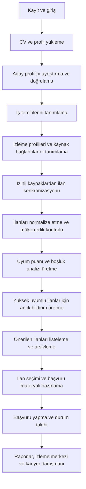

## 1. Ürün Özeti
CareerRadar AI, aktif iş başvurusu yapan adayın CV, LinkedIn profili, kariyer geçmişi ve iş tercihlerini analiz ederek uygun ilanları bulmasını, puanlamasını ve başvuru kararlarını hızlandırmasını sağlayan yapay zekâ destekli kariyer asistanıdır.
- Temel problem: Adayların farklı platformlardaki ilanları manuel takip etmesi, her ilanı kendi deneyimiyle kıyaslamasının zaman alması ve başvuru önceliğini objektif biçimde belirleyememesi.
- Hedef kullanıcı: Orta ve üst düzey profesyoneller, özellikle yönetim sorumluluğu olan adaylar; ilk sürümde ana persona QA/Test yönetimi, fintech ve e-ticaret deneyimi olan profesyoneldir.
- İş değeri: İş arama süresini kısaltır, yüksek uyumlu ilanları öne çıkarır, başvuru kalitesini artırır ve başvuru takip sürecini tek merkezde toplar.

## 2. Ürün Hedefleri ve Başarı Göstergeleri
### 2.1 Ürün Hedefleri
1. Kullanıcının CV ve profil bilgisini yapılandırılmış aday profiline dönüştürmek.
2. Kullanıcı tercihleri ve aday profilini temel alarak yüksek uyumlu ilanları öne çıkarmak.
3. Başvuru öncesi karar desteği, CV özelleştirme ve iletişim taslakları üretmek.
4. Başvuruları, görüşmeleri ve takip tarihlerini tek ekranda yönetmek.
5. Kullanıcının tanımladığı LinkedIn odaklı iş arama kriterleri için politika uyumlu sürekli izleme ve gerçek zamanlı bildirim sağlamak.

### 2.2 Başarı Göstergeleri
| Gösterge | Hedef |
|---|---|
| CV ayrıştırma doğruluğu | Kritik alanlarda yüzde 90+ kullanıcı onayı |
| İş ilanı analiz süresi | Tek ilan için 10 saniyenin altında |
| Yüksek uyumlu ilan tespit oranı | Kullanıcı tarafından yararlı bulunan önerilerde yüzde 60+ |
| Haftalık aktif kullanım | Haftada en az 3 oturum |
| Başvuruya dönüşen öneri oranı | Kaydedilen yüksek puanlı ilanların yüzde 25+ |
| Yeni ilan bildirim gecikmesi | Kaynak sisteme düşüşten sonra hedef SLA içinde 15 dakika altı |
| Kaynak senkronizasyon başarı oranı | Yüzde 98+ başarılı job run |

## 3. Çekirdek Özellikler
### 3.1 Kullanıcı Rolleri
| Rol | Kayıt Yöntemi | Temel Yetkiler |
|---|---|---|
| Aday Kullanıcı | E-posta ve şifre ile kayıt, ileride OAuth opsiyonu | Profil yönetimi, CV yükleme, ilan analizi, başvuru takibi, bildirim ayarları |
| Sistem Yöneticisi | Dahili erişim | Kaynak izleme, kuyruk/job takibi, güvenlik ve moderasyon kayıtları |

### 3.2 Özellik Modülleri
1. **Kimlik ve Hesap**: Kayıt, giriş, oturum yönetimi, parola sıfırlama, güvenlik ayarları.
2. **CV ve Profil Analizi**: PDF/DOCX yükleme, profil formu, ayrıştırma sonucu düzeltme, profesyonel özet üretimi.
3. **İş Tercihleri**: Hedef pozisyonlar, sektörler, lokasyon, çalışma modeli, maaş, dil, sponsorlu vize, relocation, hariç tutulan şirketler/pozisyonlar.
4. **İlan Toplama ve İçe Aktarım**: Kullanıcının verdiği ilan bağlantıları, izinli veri kaynakları, manuel ekleme ve ileride API/RSS entegrasyonları.
5. **Akıllı Eşleştirme ve Puanlama**: Ağırlıklı skor, açıklanabilir alt skorlar, eksik yetkinlik analizi, mükerrer ilan birleştirme.
6. **Başvuru Hazırlığı**: Pozisyona özel CV özeti, ön yazı, LinkedIn mesajı, e-posta taslağı, ATS anahtar kelimeleri.
7. **Başvuru Takibi**: Durum yönetimi, görüşme takvimi, notlar, maaş alanları, hatırlatmalar.
8. **Dashboard ve Raporlar**: Trendler, dönüşüm oranları, eksik yetkinlikler, platform/lokasyon dağılımları.
9. **Bildirimler**: Uygulama içi, e-posta, günlük/haftalık özet, ileriki sürümde Telegram.
10. **Yapay Zekâ Kariyer Danışmanı**: İlan bazlı tavsiye, CV yönlendirmesi, mülakat hazırlığı ve yetkinlik boşluğu analizi.
11. **Sürekli İş İzleme**: Kullanıcı tanımlı arama profilleri, izleme sıklığı, kaynak senkronizasyon durumları, hata kayıtları ve arşiv görünümü.

### 3.3 Sayfa Detayları
| Sayfa Adı | Modül Adı | Özellik Açıklaması |
|---|---|---|
| Dashboard | KPI kartları | Toplam ilan, yüksek uyumlu ilan, yeni ilanlar, başvuru dönüşüm oranları |
| Dashboard | Hızlı aksiyonlar | CV yükle, tercihleri güncelle, ilan bağlantısı ekle, haftalık özet görüntüle |
| İş İlanları | Tablo/kart görünümü | Filtreleme, sıralama, uyum puanı, kaynak, lokasyon, tarih, kaydet/analiz et |
| Önerilen İlanlar | Öncelik kuyruğu | En yüksek puanlı ve en kısa aksiyon gerektiren ilanlar |
| Kaydedilen İlanlar | Kişisel kısa liste | Kullanıcının işaretlediği ilanlar ve notları |
| Başvurularım | Pipeline görünümü | Durum bazlı takip, hatırlatmalar, maaş ve görüşme alanları |
| Görüşmeler | Takvim ve liste | Görüşme tarihi, kişi, kanal, hazırlık notu |
| CV ve Profil | Dosya yükleme | Türkçe/İngilizce CV, LinkedIn veri girişi, ayrıştırma sonucu doğrulama |
| CV ve Profil | Yapılandırılmış profil | Ünvanlar, deneyimler, ekip büyüklüğü, araçlar, sertifikalar |
| Kariyer Analizi | Profil özeti | Hedef roller, güçlü yönler, eksik yetkinlikler, önerilen aksiyonlar |
| Raporlar | Analitik panolar | Yetkinlik trendleri, kaynak performansı, lokasyon dağılımı |
| Bildirimler | Kural merkezi | Skor eşiği, öncelikli şirketler, özet periyotları |
| İzleme Merkezi | Arama profilleri | LinkedIn arama kriterleri, tarama sıklığı, son senkronizasyon zamanı, hata durumu |
| İzleme Merkezi | Kaynak uyumu | Resmî API, kullanıcı e-posta yönlendirmesi, kullanıcı sağladığı arama URL’leri ve manuel içe aktarma durumu |
| Arşiv | Eşleşen ilan geçmişi | Kaynağa göre tüm eşleşmeler, durum, ilk görülme zamanı, son görülme zamanı, bildirim geçmişi |
| Ayarlar | Gizlilik ve güvenlik | Veri silme, veri dışa aktarma, bildirim ve entegrasyon ayarları |

## 4. Temel Kullanıcı Akışları
Kullanıcı önce hesabını oluşturur, CV ve profil verilerini yükler, ardından sistem yapılandırılmış aday profili üretir. Kullanıcı iş tercihlerini belirler ve LinkedIn ağırlıklı arama profilleri tanımlar. Sistem yalnızca izinli ve politika uyumlu kaynaklardan gelen ilanları senkronize eder, normalize eder ve eşleşme skorunu üretir. Yüksek uyumlu yeni ilanlar için gerçek zamanlı bildirim üretir. Kullanıcı uygun ilanları kaydeder, başvuru materyallerini hazırlar ve başvuru sürecini yaşam döngüsü boyunca takip eder.

## 5. Kullanıcı Arayüzü Tasarımı
### 5.1 Tasarım Dili
- Ana ton: Yönetici seviyesine uygun sade, güven veren ve veri yoğun ama okunabilir arayüz.
- Renkler: Koyu lacivert/grafit taban, vurgu için zümrüt veya elektrik mavi; başarı, risk ve uyarı renkleri net ayrışmalı.
- Buton stili: Yuvarlatılmış köşeli, yüksek kontrastlı birincil buton; ikincil aksiyonlarda hafif konturlu stil.
- Tipografi: Başlıklarda karakterli ama profesyonel bir sans font, içerikte yüksek okunabilir modern sans font.
- Yerleşim: Desktop-first, sol menü + üst aksiyon bar + içerikte kart ve veri tablosu hibriti.
- İkon stili: Çizgisel, kurumsal ve minimum dikkat dağıtan.

### 5.2 Sayfa Tasarım Özeti
| Sayfa Adı | Modül Adı | UI Öğeleri |
|---|---|---|
| Dashboard | KPI alanı | Geniş kartlar, trend etiketleri, mini grafikler |
| İş İlanları | Listeleme | Kart ve tablo geçişi, sticky filtre paneli, skor rozeti |
| İlan Detayı | Analiz | Alt skor çubukları, eksik yetkinlik etiketi, açıklama kutuları |
| CV ve Profil | Düzenleme | Sekmeli yapı, dosya yükleme alanı, doğrulama uyarıları |
| Başvurularım | Pipeline | Durum sütunları veya yoğun veri için tablo görünümü |
| Raporlar | Analitik | Bar chart, donut chart, zaman serisi grafikler |
| İzleme Merkezi | Operasyon paneli | Senkronizasyon durumu, job log özetleri, hata sayısı, SLA göstergeleri |

### 5.3 Duyarlılık
- Desktop-first yaklaşım kullanılacaktır.
- Tablet görünümünde filtreler çekmece yapısına alınacaktır.
- Mobil görünüm MVP sonrası optimize edilecektir ancak temel okunabilirlik korunacaktır.

## 6. Persona ve Kapsam
### 6.1 Birincil Persona
- 12+ yıl deneyimli, QA/Test yönetimi geçmişi olan, fintech ve e-ticaret tecrübesi bulunan profesyonel aday.
- İngilizce ve Türkçe başvuru yapabilir.
- Yönetici, lead ve senior manager seviyesinde rolleri hedefler.
- Hedefi: En uygun ilanları hızlı ayıklamak, başvuru kalitesini artırmak ve süreç takibini kaybetmemek.

### 6.2 İkincil Persona
- Daha genel teknoloji profesyonelleri; ilk sürüm bu kitleye de hizmet verir ancak puanlama modeli ilk etapta QA/Test yönetimi odaklı profile göre optimize edilir.

## 7. MVP Kapsamı
### 7.1 MVP İçine Dahil
1. Kullanıcı kaydı ve giriş.
2. Türkçe ve İngilizce CV yükleme.
3. PDF ve DOCX ayrıştırma; kullanıcı doğrulama/düzeltme ekranı.
4. Yapılandırılmış aday profili oluşturma.
5. İş tercihleri yönetimi.
6. Kullanıcının ilan bağlantısı ekleyebilmesi ve ilan metninin analiz edilmesi.
7. CV ile ilan arasında uyum puanı hesaplanması.
8. Eksik yetkinlikler ve açıklanabilir eşleşme analizi.
9. İlan kaydetme.
10. Başvuru durumu takibi.
11. Pozisyona özel CV önerileri.
12. Ön yazı, LinkedIn mesajı ve e-posta taslağı üretimi.
13. Temel dashboard.
14. Günlük veya haftalık özet üretimi.
15. Kullanıcı tanımlı iş arama profilleri oluşturma.
16. LinkedIn odaklı politika uyumlu sürekli izleme akışı.
17. Yüksek skor eşiklerinde anlık uygulama içi ve e-posta bildirimleri.
18. İzleme geçmişi, arşiv görünümü ve son senkronizasyon kayıtları.
19. Ayarlanabilir tarama/senkronizasyon sıklığı.
20. Operasyonel loglama ve hata yönetimi görünürlüğü.

### 7.2 MVP Dışında
- Otomatik çoklu platform ilan tarama entegrasyonları.
- E-posta kutusundaki ilan bildirimlerini otomatik okuma.
- Telegram bildirimleri.
- Maaş benchmark ve şirket kültürü analizi.
- Mülakat simülasyonu ve sesli prova.
- Çoklu CV strateji motoru.
- Mobil uygulama.
- Kullanıcı davranışından öğrenen öneri sistemi.
- LinkedIn üzerinde politika dışı scraping veya onaysız otomasyon.

### 7.3 MVP Başarı Kriterleri
- Kullanıcı CV yükleyip aday profilini onaylayabilmeli.
- En az bir ilan URL'si üzerinden analiz akışı tamamlanabilmeli.
- Sistem ilan için alt skorları ve toplam uyum puanını üretebilmeli.
- Kullanıcı başvuru materyali oluşturup başvuru durumu kaydı açabilmeli.
- Dashboard temel metrikleri gösterebilmeli.
- Kullanıcı en az bir izleme profili tanımlayıp senkronizasyon sıklığını belirleyebilmeli.
- Sistem yeni gelen yüksek uyumlu ilan için bildirim oluşturabilmeli.
- Arşiv ekranı ilk görülme, son görülme ve bildirim durumu bilgilerini gösterebilmeli.

## 8. Kullanıcı Hikâyeleri
1. Bir aday olarak Türkçe ve İngilizce CV'mi yükleyip sistemin deneyimlerimi otomatik çıkarmasını isterim; böylece profilimi sıfırdan girmek zorunda kalmam.
2. Bir aday olarak LinkedIn profil bilgilerimi ekleyip CV ile birleştirmek isterim; böylece daha doğru eşleşmeler alırım.
3. Bir aday olarak hedeflediğim pozisyonları, şehirleri, maaş beklentimi ve çalışma modelimi tanımlamak isterim; böylece ilgisiz ilanlar elenir.
4. Bir aday olarak bir iş ilanı bağlantısı eklediğimde sistemin ilanı analiz etmesini isterim; böylece ilanın bana ne kadar uygun olduğunu hızlıca görürüm.
5. Bir aday olarak her ilanın neden yüksek veya düşük puan aldığını görmek isterim; böylece skora güvenebilirim.
6. Bir aday olarak eksik yetkinliklerimi ve güçlü yanlarımı ilan bazında görmek isterim; böylece CV'mde neyi vurgulayacağımı bilirim.
7. Bir aday olarak başvuracağım ilan için pozisyona özel ön yazı ve kısa mesaj taslağı üretmek isterim; böylece başvuru hızım artar.
8. Bir aday olarak başvurduğum şirketlerin hangi aşamada olduğunu takip etmek isterim; böylece süreci tek merkezden yönetirim.
9. Bir aday olarak belirli puanın üzerindeki yeni ilanlar için özet almak isterim; böylece fırsatları kaçırmam.
10. Bir aday olarak kariyer danışmanına "Bu ilana başvurmalı mıyım?" diye sorup yanıtın kendi profilime dayanmasını isterim; böylece daha bilinçli karar veririm.
11. Bir aday olarak LinkedIn odaklı arama kriterlerimi tek kez tanımlayıp sistemin bunları sürekli izlemesini isterim; böylece manuel kontrol yüküm azalır.
12. Bir aday olarak yeni ve yüksek uyumlu ilanlar çıktığında anında bildirim almak isterim; böylece hızlı başvuru avantajı kazanırım.
13. Bir aday olarak tüm eşleşen ilanları arşivde görebilmek isterim; böylece neyin ne zaman bulunduğunu kaybetmem.
14. Bir aday olarak tarama job’larında hata olursa bunu görebilmek isterim; böylece izleme sistemine güvenebilirim.

## 9. Fonksiyonel Gereksinimler
### 9.1 Hesap ve Erişim
- FR-1: Sistem e-posta ve parola ile kullanıcı kaydı desteklemelidir.
- FR-2: Kullanıcı güvenli oturum açma ve çıkış işlemlerini gerçekleştirebilmelidir.
- FR-3: Kullanıcı kendi verisini silme ve dışa aktarma talebini başlatabilmelidir.

### 9.2 CV ve Profil Analizi
- FR-4: Sistem PDF ve DOCX formatlarını kabul etmelidir.
- FR-5: Sistem CV'den ünvan, şirket, deneyim süresi, araçlar, sertifikalar, eğitim ve diller gibi alanları çıkarmalıdır.
- FR-6: Sistem ayrıştırma sonucunu düzenlenebilir biçimde göstermelidir.
- FR-7: Sistem profesyonel özet ve hedef pozisyon önerileri üretebilmelidir.

### 9.3 İş Tercihleri
- FR-8: Kullanıcı tercih edilen pozisyon, sektör, şehir/ülke, çalışma modeli, maaş beklentisi, ilan dili ve vize/relocation alanlarını tanımlayabilmelidir.
- FR-9: Kullanıcı başvurmak istemediği şirket ve pozisyonları belirleyebilmelidir.
- FR-10: Kullanıcı minimum ilan uyum puanını belirleyebilmelidir.

### 9.4 İlan Analizi ve Eşleştirme
- FR-11: Kullanıcı bir ilan bağlantısı eklediğinde sistem ilan içeriğini normalize ederek kaydetmelidir.
- FR-12: Sistem ilan için toplam skor ve alt skorlar üretmelidir.
- FR-13: Sistem zorunlu ve tercih edilen yetkinlikleri ayrıştırmalıdır.
- FR-14: Sistem mükerrer ilanları tespit edip tek kayıt altında ilişkilendirmelidir.
- FR-15: Kullanıcı puanlama ağırlıklarını ayarlayabilmelidir.
- FR-15A: Kullanıcı arama profilleri tanımlayabilmeli; bu profiller pozisyon, konum, sektör, deneyim seviyesi, pozisyon türü ve çalışma modelini içermelidir.
- FR-15B: Sistem LinkedIn odaklı senkronizasyonu yalnız izinli ve kullanım koşullarına uygun kaynaklardan gerçekleştirmelidir.
- FR-15C: Sistem kullanıcı tanımlı tarama sıklığını desteklemelidir.
- FR-15D: Sistem her kaynak senkronizasyonu için başarılı/başarısız run kaydı tutmalıdır.

### 9.5 Başvuru Hazırlığı
- FR-16: Sistem ilan bazlı Türkçe ve İngilizce CV özeti önermelidir.
- FR-17: Sistem ATS anahtar kelimelerini ve eksik anahtar kelimeleri listelemelidir.
- FR-18: Sistem ön yazı, kısa mesaj ve e-posta taslağı üretebilmelidir.
- FR-19: Sistem gerçek dışı bilgi eklememeli ve kullanıcıya açık uyarı göstermelidir.

### 9.6 Başvuru Takibi ve Bildirim
- FR-20: Kullanıcı başvuru durumlarını güncelleyebilmelidir.
- FR-21: Sistem görüşme tarihi, notlar, maaş alanları ve hatırlatma tarihini saklamalıdır.
- FR-22: Sistem günlük veya haftalık özet oluşturabilmelidir.
- FR-23: Sistem yüksek puanlı yeni ilanlar için bildirim kuralı çalıştırabilmelidir.
- FR-23A: Sistem yeni bulunan ilanı daha önce görülmüş ilanlarla karşılaştırıp arşive tekil kayıt olarak yazmalıdır.
- FR-23B: Sistem yüksek uyumlu ve yeni ilanları gerçek zamanlıya yakın biçimde uygulama içi ve e-posta kanallarına iletmelidir.
- FR-23C: Sistem kullanıcıya izleme job hata kayıtlarını ve son başarılı senkronizasyon zamanını göstermelidir.

### 9.7 Danışman ve Raporlama
- FR-24: Sistem ilan veya profil bazlı danışman yanıtı üretmelidir.
- FR-25: Yanıtlar veri yetersiz olduğunda varsayım içerdiğini açıkça belirtmelidir.
- FR-26: Dashboard temel metrikleri ve dağılımları göstermelidir.

## 10. Fonksiyonel Olmayan Gereksinimler
- NFR-1: Sistem modüler ve ölçeklenebilir mimariye sahip olmalıdır.
- NFR-2: Kritik API uç noktaları p95 düzeyinde 500 ms altında yanıt vermelidir; LLM işlemleri asenkron yürütülebilir.
- NFR-3: Hassas veriler şifreli saklanmalı ve aktarım sırasında TLS kullanılmalıdır.
- NFR-4: Kişisel veriler loglarda maskelenmelidir.
- NFR-5: Ayrıştırma veya analiz hatalarında kullanıcı anlaşılır hata mesajı görmelidir.
- NFR-6: Uygulama Türkçe karakterleri ve çok dilli içerikleri doğru işlemelidir.
- NFR-7: Tüm temel akışlar denetlenebilir olay kayıtları ile izlenebilmelidir.
- NFR-8: Sistem KVKK ve GDPR uyumunu destekleyecek veri saklama/silme mekanizmalarına sahip olmalıdır.
- NFR-9: Kod tabanı test edilebilir, gözlemlenebilir ve CI/CD ile yayınlanabilir olmalıdır.
- NFR-10: Kaynak senkronizasyon işleri yeniden denenebilir ve idempotent olmalıdır.
- NFR-11: İzleme sıklığı kullanıcı bazında ayarlanabilir olmalı, varsayılan güvenli limitler uygulanmalıdır.
- NFR-12: LinkedIn politika riski oluşturan davranışlardan kaçınılmalı; scraping, agresif istek paterni veya onaysız giriş otomasyonu uygulanmamalıdır.

## 11. Kabul Kriterleri
### 11.1 İşlevsel Kabul Kriterleri
- Kullanıcı kayıt olur, giriş yapar ve oturumunu güvenli biçimde sürdürebilir.
- Kullanıcı en az bir CV yükleyip ayrıştırma sonucunu düzenleyebilir.
- Kullanıcı tercihlerini kaydedip sonradan güncelleyebilir.
- Kullanıcı ilan URL'si eklediğinde sistem ilanı okuyup temel alanları çıkartır.
- Sistem ilan için toplam skor ve alt skorları görüntüler.
- Sistem eksik yetkinlikleri ve başvuru öneri kategorisini açık nedenlerle gösterir.
- Kullanıcı bir ilanı kaydedebilir ve başvuru kaydı açabilir.
- Sistem pozisyona özel CV özeti ve mesaj taslakları oluşturur.
- Dashboard minimum çekirdek metrikleri görüntüler.
- İzleme profili tanımlandıktan sonra sistem ilk senkronizasyon kaydını oluşturur.
- Yüksek uyumlu yeni ilan bulunduğunda bildirim kaydı oluşur.
- Arşiv ekranı eşleşen ilanların geçmişini ve kaynak durumunu gösterebilir.

### 11.2 Kalite Kabul Kriterleri
- Kritik kullanıcı akışları için temel entegrasyon testleri bulunur.
- Dosya yükleme, kimlik doğrulama ve veri erişim kontrolleri negatif senaryoları kapsar.
- Hatalar kullanıcı dostu mesajlarla yönetilir; PII loglara düz metin olarak düşmez.

## 12. Teknik Kararlar İçin Ürün Gerekçeleri
- Kullanıcı onayı olmadan otomatik başvuru dışarıda bırakılır; güven ve etik risk azaltılır.
- İlk sürümde kullanıcı tarafından sağlanan ilan URL'leri ile başlamak seçilir; böylece yasal risk ve entegrasyon karmaşıklığı düşer.
- Açıklanabilir puanlama zorunlu tutulur; kullanıcı "neden bu skor?" sorusuna yanıt alır.
- Profil doğrulama ekranı eklenir; CV ayrıştırma hatalarının ürün güvenini bozması önlenir.

## 13. Varsayımlar
- İlk sürüm tek kullanıcı hesabı odağında tasarlanacaktır; çok kiracılı kurumsal kullanım sonraki fazdadır.
- LinkedIn ve diğer platformlardan doğrudan scraping yapılmayacak; kullanıcı sağladığı veri, resmî API, izinli entegrasyonlar, kullanıcı e-posta yönlendirmesi ve kullanıcı tanımlı arama profillerinden türetilen uyumlu kaynak akışları kullanılacaktır.
- Maaş verisi çoğu ilanda eksik olabileceğinden alan opsiyonel tutulacaktır.
- İlk sürüm Türkçe arayüz önceliklidir; içerik üretimi Türkçe ve İngilizceyi destekler.
- Yönetici ve QA odaklı eşleşme modeli başlangıçta kural tabanlı + LLM destekli hibrit olacaktır.
- Sürekli LinkedIn takibi, öncelikle kullanıcıya ait arama profilleri ve bildirim/e-posta akışlarının sisteme bağlanması üzerinden çözülecektir.

## 14. Güvenlik, Gizlilik ve Etik Riskler
- CV ve kişisel veriler hassas veri sınıfında ele alınmalıdır; veri sızıntısı ana risktir.
- LLM'e gönderilen veri minimum gerekli alanlarla sınırlandırılmalıdır.
- Otomatik metin üretiminde gerçeğe aykırı ifade önerme riski vardır; doğrulama uyarıları zorunlu tutulmalıdır.
- İlan kaynağının erişim şartları ihlal edilmemelidir; resmi API, RSS, kullanıcı girdisi ve izinli entegrasyonlar tercih edilmelidir.
- Bildirim ve e-posta özellikleri kullanıcı açık onayı olmadan otomatik işlem başlatmamalıdır.
- LinkedIn hesap kısıtlaması riski nedeniyle doğrudan bot davranışı, agresif periyotlar ve görünür scraping desenleri tasarım dışı bırakılmalıdır.
- Tarama geçmişi, iş arama kriterleri ve ilan etkileşimleri kullanıcı açısından hassas davranışsal veri olarak korunmalıdır.

## 15. Açık Sorular
- İlk sürümde tek kullanıcı mı hedeflenecek, yoksa birden fazla aday hesabı desteklenecek mi?
- Hangi ilan kaynakları için resmî API/izinli entegrasyon erişimi mevcut olacak?
- E-posta özetleri için hangi e-posta sağlayıcısı tercih edilecek?
- Maaş benchmark verisi dış servisle mi yoksa sonraki sürümle mi ele alınacak?
- LinkedIn arama profilleri için kullanıcı e-posta yönlendirmesi mi, kullanıcı sağladığı arama URL’leri mi, yoksa resmî partner API erişimi mi ilk kanal olacak?

## 16. Bu Aşamada Üretilecek Dosyalar
- `.trae/documents/careerradar-ai-prd.md`
- `.trae/documents/careerradar-ai-teknik-mimari.md`
