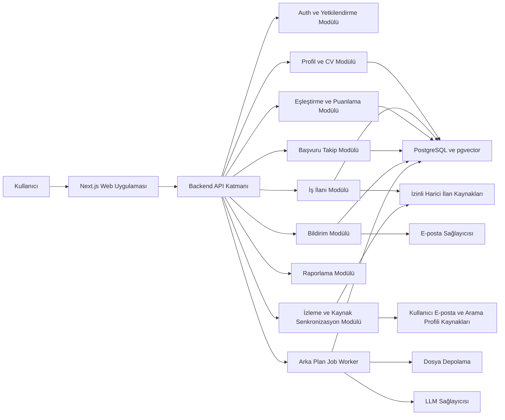
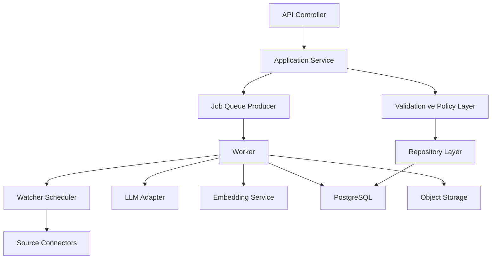
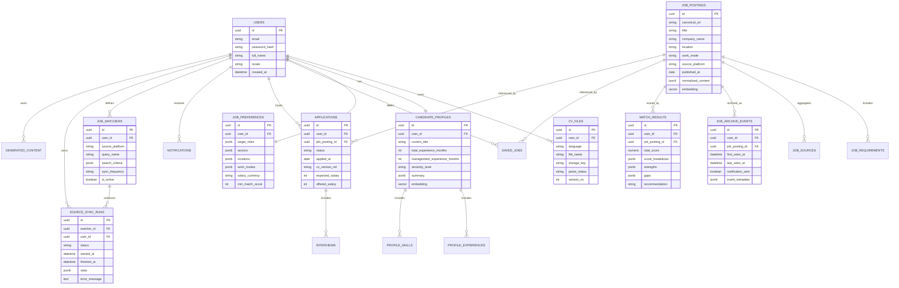

## 1. Mimari Tasarım
CareerRadar AI için önerilen yapı, modüler monolit yaklaşımıyla başlayan ve ihtiyaç halinde servisleşmeye evrilebilen bir mimaridir. İlk sürümde tek deployable backend ve tek frontend uygulaması tercih edilir; bu yaklaşım geliştirme hızını artırırken domain sınırlarını temiz tutarak ileride ölçeklenmeye izin verir.



## 2. Teknoloji Açıklaması
- Frontend: `Next.js 15` + `TypeScript` + `Tailwind CSS` + modern component library.
- Backend: `Python FastAPI` + `SQLAlchemy` + `Pydantic`.
- Veritabanı: `PostgreSQL 16` + `pgvector`.
- Arka plan işleri: `Celery` veya `RQ` + `Redis`.
- Dosya depolama: S3 uyumlu obje depolama.
- Kimlik doğrulama: JWT tabanlı session access/refresh token modeli.
- Gözlemlenebilirlik: Yapılandırılmış loglama, hata izleme ve temel metrik toplama.
- Konteynerleşme: Docker Compose ile yerel geliştirme, ileride Kubernetes veya managed container platformuna geçiş.

## 3. Teknik Kararlar ve Gerekçeleri
- `Next.js` seçimi: Dashboard, veri yoğun ekranlar ve gelecekte SSR/SEO ihtiyacı için güçlü temel sağlar.
- `FastAPI` seçimi: Veri doğrulama, tip güvenliği ve LLM/ML odaklı Python ekosistemi ile uyumludur.
- Modüler monolit seçimi: MVP hızını korur; erken servisleşmenin operasyonel maliyetini önler.
- `PostgreSQL + pgvector` seçimi: Hem ilişkisel veri hem semantik eşleştirme tek veri katmanında tutulabilir.
- Asenkron job worker seçimi: CV ayrıştırma, embedding üretimi, özet hazırlama ve bildirim işleri API gecikmesinden ayrılır.
- Hibrit eşleştirme yaklaşımı: Kural tabanlı skorlamayı LLM destekli açıklama ve anlamsal benzerlik ile birleştirir; açıklanabilirlik korunur.
- LinkedIn politika uyumu: Doğrudan scraping yerine kullanıcı tarafından yetkilendirilmiş arama profilleri, e-posta/job alert ingest ve resmî/izinli entegrasyon kanalları tercih edilir.

## 4. Bileşen ve Domain Sınırları
### 4.1 Frontend Katmanı
- Kimlik ve oturum ekranları
- Dashboard ve rapor panelleri
- CV/profil yönetimi
- İş tercihleri yönetimi
- İlan listeleme ve ilan detay analizi
- Başvuru pipeline ekranı
- Bildirim merkezi
- Yapay zekâ kariyer danışmanı sohbet paneli

### 4.2 Backend Domain Modülleri
| Modül | Sorumluluk |
|---|---|
| Auth | Kullanıcı, oturum, parola sıfırlama, RBAC |
| Candidate Profile | CV, LinkedIn verisi, yapılandırılmış profil, versiyonlama |
| Job Ingestion | İlan URL alma, içerik temizleme, normalizasyon, mükerrerlik |
| Matching | Alt skorlar, toplam skor, eksik yetkinlik, açıklamalar |
| Application Tracking | Başvuru kaydı, durum değişimleri, notlar, maaş ve görüşme alanları |
| Content Generation | CV özeti, ön yazı, mesaj taslakları, anahtar kelime önerileri |
| Notifications | Uygulama içi bildirimler, e-posta özetleri, kural motoru |
| Analytics | Dashboard metrikleri, trendler, rapor sorguları |
| Audit & Privacy | Veri dışa aktarma, veri silme, erişim ve işlem kayıtları |
| Watchers & Source Sync | Arama profilleri, senkronizasyon job’ları, run geçmişi, hata yönetimi, hız limitleri |

## 5. Rota Tanımları
| Rota | Amaç |
|---|---|
| `/login` | Giriş |
| `/register` | Kayıt |
| `/dashboard` | Ana panel ve KPI görünümü |
| `/jobs` | Tüm ilan listesi ve filtreler |
| `/jobs/[id]` | İlan detayı ve uyum analizi |
| `/recommended` | Önerilen ilanlar |
| `/saved-jobs` | Kaydedilen ilanlar |
| `/applications` | Başvuru takibi |
| `/interviews` | Görüşme listesi ve takvim |
| `/profile` | CV ve profil yönetimi |
| `/career-analysis` | Kariyer özeti ve eksik yetkinlik analizi |
| `/reports` | Analitik raporlar |
| `/notifications` | Bildirim merkezi |
| `/watchers` | Arama profilleri, senkronizasyon durumu ve hata görünürlüğü |
| `/archive` | Eşleşen ilan arşivi ve bildirim geçmişi |
| `/settings` | Güvenlik, gizlilik ve tercih ayarları |

## 6. API Tanımları
İlk sürüm için REST API yaklaşımı önerilir. Uzun süren işlemler asenkron job başlatır ve istemci polling veya SSE ile sonuç takibi yapar.

### 6.1 Kimlik Doğrulama
```ts
type RegisterRequest = {
  email: string;
  password: string;
  fullName: string;
};

type AuthResponse = {
  userId: string;
  accessToken: string;
  refreshToken: string;
  expiresIn: number;
};
```

### 6.2 Profil ve CV
```ts
type CandidateProfile = {
  id: string;
  currentTitle?: string;
  totalExperienceMonths?: number;
  managementExperienceMonths?: number;
  targetRoles: string[];
  preferredSectors: string[];
  preferredLocations: string[];
  workModes: Array<"remote" | "hybrid" | "onsite">;
  skills: string[];
  certifications: string[];
  languages: Array<{ name: string; level: string }>;
};

type CvParseJobResponse = {
  jobId: string;
  status: "queued" | "processing" | "completed" | "failed";
};
```

### 6.3 İlan ve Eşleştirme
```ts
type JobCreateByUrlRequest = {
  sourceUrl: string;
  sourcePlatform?: string;
};

type MatchScoreBreakdown = {
  title: number;
  experience: number;
  technicalSkills: number;
  leadership: number;
  industry: number;
  locationAndWorkMode: number;
  language: number;
  educationAndCertificates: number;
  salaryAndBenefits: number;
};

type JobMatchResponse = {
  jobId: string;
  totalScore: number;
  priority: string;
  recommendation: string;
  breakdown: MatchScoreBreakdown;
  strengths: string[];
  gaps: string[];
  atsKeywords: string[];
};
```

### 6.4 Başvuru Takibi
```ts
type ApplicationStatus =
  | "discovered"
  | "to_review"
  | "to_apply"
  | "applied"
  | "hr_interview"
  | "technical_interview"
  | "manager_interview"
  | "offer_pending"
  | "offer_received"
  | "rejected"
  | "withdrawn";
```

### 6.5 Önerilen İlk Uç Noktalar
| Metot | Endpoint | Amaç |
|---|---|---|
| `POST` | `/api/v1/auth/register` | Kayıt |
| `POST` | `/api/v1/auth/login` | Giriş |
| `POST` | `/api/v1/files/cv` | CV yükleme |
| `POST` | `/api/v1/cv/parse` | Ayrıştırma job'ı başlatma |
| `GET` | `/api/v1/cv/parse/{jobId}` | Ayrıştırma durumunu alma |
| `GET` | `/api/v1/profile` | Profil getirme |
| `PUT` | `/api/v1/profile` | Profil güncelleme |
| `PUT` | `/api/v1/preferences` | İş tercihlerini güncelleme |
| `POST` | `/api/v1/jobs/import-url` | URL ile ilan içe aktarma |
| `GET` | `/api/v1/jobs` | İlan listesi |
| `GET` | `/api/v1/jobs/{jobId}` | İlan detayı |
| `POST` | `/api/v1/jobs/{jobId}/analyze` | İlan analizi ve skor üretimi |
| `POST` | `/api/v1/jobs/{jobId}/save` | İlan kaydetme |
| `POST` | `/api/v1/jobs/{jobId}/generate-materials` | CV özeti ve mesaj taslakları |
| `GET` | `/api/v1/applications` | Başvuru listesi |
| `POST` | `/api/v1/applications` | Başvuru kaydı oluşturma |
| `PATCH` | `/api/v1/applications/{applicationId}` | Durum veya alan güncelleme |
| `GET` | `/api/v1/dashboard/summary` | Dashboard özet metrikleri |
| `GET` | `/api/v1/notifications` | Bildirim listesi |
| `POST` | `/api/v1/advisor/query` | Kariyer danışmanı sorusu |
| `GET` | `/api/v1/watchers` | İzleme profillerini listeleme |
| `POST` | `/api/v1/watchers` | Yeni arama/izleme profili oluşturma |
| `PATCH` | `/api/v1/watchers/{watcherId}` | İzleme sıklığı ve kriterleri güncelleme |
| `POST` | `/api/v1/watchers/{watcherId}/run` | Manuel senkronizasyon tetikleme |
| `GET` | `/api/v1/watchers/{watcherId}/runs` | Senkronizasyon geçmişi ve hata kayıtları |
| `GET` | `/api/v1/archive/jobs` | Arşivlenen eşleşen ilanları listeleme |
| `GET` | `/api/v1/archive/jobs/{jobId}` | Arşiv ilan detayı ve bildirim geçmişi |

## 7. Sunucu Mimarisi Diyagramı


## 8. Veri Modeli
### 8.1 Veri Modeli Tanımı


### 8.2 İlk DDL Yönü
- Tüm ana tablolarda `created_at`, `updated_at`, gerekirse `deleted_at` alanları bulunmalıdır.
- `users.email`, `job_postings.canonical_url` ve `match_results(user_id, job_posting_id)` üzerinde unique/index stratejisi olmalıdır.
- `job_postings`, `candidate_profiles` için `pgvector` embedding alanları ve yakın komşu arama indeksleri oluşturulmalıdır.
- `applications.status`, `notifications.type`, `cv_files.parse_status` alanları enum veya check constraint ile sınırlandırılmalıdır.
- `job_watchers.sync_frequency`, `source_sync_runs.status`, `job_archive_events.notification_sent` alanları indekslenmeli ve kısıtlanmalıdır.
- `job_watchers(user_id, query_name)` ve `job_archive_events(user_id, job_posting_id)` için benzersizlik stratejisi uygulanmalıdır.

## 9. İş İlanı Eşleştirme ve Puanlama Mimarisi
### 9.1 Puanlama Katmanları
1. Kural tabanlı zorunlu alan eşleştirme.
2. Semantik benzerlik ile profil ve ilan metni yakınlığı.
3. LLM destekli boşluk analizi ve açıklama üretimi.
4. Kullanıcı ayarlanabilir ağırlıklarla toplam skor hesaplama.

### 9.2 Varsayılan Ağırlıklar
| Boyut | Ağırlık |
|---|---|
| Pozisyon unvanı uyumu | 15 |
| Deneyim seviyesi uyumu | 15 |
| Teknik yetkinlik uyumu | 20 |
| Yönetim ve liderlik deneyimi uyumu | 15 |
| Sektör uyumu | 10 |
| Lokasyon ve çalışma modeli uyumu | 10 |
| Dil gereksinimi uyumu | 5 |
| Eğitim ve sertifika uyumu | 5 |
| Maaş ve yan hak beklentisi uyumu | 5 |

### 9.3 Puanlama Akışı
- İlan metni normalize edilir ve gereksinimler ayrıştırılır.
- Aday profilinden yapılandırılmış yetkinlik ve deneyim sinyalleri çıkarılır.
- Her boyut için 0 ile 1 arasında normalize edilmiş alt skor üretilir.
- Kullanıcı ağırlıkları uygulanarak 0 ile 100 arası toplam skor hesaplanır.
- Eşik ve kurallara göre başvuru öneri etiketi atanır.
- Sonuç, açıklanabilir nedenler ve eksik yetkinlik listesi ile saklanır.

## 10. Arka Plan İşleri ve Zamanlama
| Job | Tetikleyici | Amaç |
|---|---|---|
| CV Parse Job | CV yükleme | Metin çıkarma, bölümleme, alan ayrıştırma |
| Profile Enrichment Job | Profil onayı | Özet, anahtar kelime ve embedding üretme |
| Job Import Job | İlan URL ekleme | İçerik çekme, temizleme, normalizasyon |
| Deduplication Job | Yeni ilan kaydı | Benzer URL/içerik kontrolü |
| Match Calculation Job | Yeni ilan veya profil değişimi | Skor ve açıklama üretme |
| Daily Digest Job | Günlük zamanlayıcı | Günlük özet hazırlama |
| Weekly Digest Job | Haftalık zamanlayıcı | Haftalık rapor hazırlama |
| Reminder Job | Zamanlayıcı | Son başvuru ve takip mesajı bildirimleri |
| Watcher Sync Job | Cron veya kullanıcı tetiklemesi | Arama profiline göre yeni ilanları senkronize etme |
| Source Ingest Job | E-posta veya uyumlu kaynak girişi | LinkedIn odaklı ilan akışını normalize etme |
| Archive Update Job | Yeni veya güncel ilan | İlk görülme, son görülme ve bildirim geçmişini güncelleme |
| Alert Dispatch Job | Eşik aşan yeni eşleşme | Gerçek zamanlı bildirim üretme |

## 11. Güvenlik ve KVKK Mimari Gereksinimleri
- Hassas alanlar için uygulama seviyesinde şifreleme veya KMS destekli alan şifrelemesi uygulanmalıdır.
- Şifreler `argon2` veya eşdeğer güçlü algoritma ile hashlenmelidir.
- Access token kısa ömürlü, refresh token döndürülebilir olmalıdır.
- Kullanıcı dosyaları özel bucket içinde tutulmalı, imzalı URL ile erişilmelidir.
- LLM sağlayıcısına gönderilen veri en aza indirilmeli, mümkünse PII maskelenmelidir.
- Veri silme talebi kullanıcı bazında ilişkisel ve obje depolama kayıtlarını kapsamalıdır.
- Audit log kayıtları değiştirilemez mantıkla saklanmalı ve PII maskelemesi uygulanmalıdır.
- Yetkilendirme kontrolleri her API katmanında zorunlu olmalıdır.
- Kaynak senkronizasyon modülü hız limiti, jitter ve exponential backoff uygulamalıdır.
- LinkedIn veya benzeri platformlarda kullanım politikalarını ihlal edecek giriş otomasyonu, görünür scraping veya agresif polling yapılmamalıdır.

## 12. Hata Yönetimi, Loglama ve Gözlemlenebilirlik
- Tüm API hataları standart hata şeması ile dönmelidir.
- Domain olayları için korelasyon kimliği kullanılmalıdır.
- Dış servis çağrıları için timeout, retry ve circuit breaker yaklaşımı uygulanmalıdır.
- LLM ve job süreçleri için başarı, hata, gecikme ve token kullanımı ölçülmelidir.
- Kullanıcıya gösterilen hata mesajları sade; geliştirici logları ise yapılandırılmış ve detaylı olmalıdır.
- Her watcher run için korelasyon ID, kaynak adı, duration, yeni ilan sayısı, hata nedeni ve bildirim sayısı loglanmalıdır.

## 13. İlk Proje Klasör Yapısı Önerisi
```text
careerradar-ai/
  apps/
    web/
      src/
        app/
        components/
        features/
        lib/
        hooks/
    api/
      app/
        api/
        core/
        domains/
          auth/
          profile/
          jobs/
          watchers/
          matching/
          applications/
          notifications/
          advisor/
        infrastructure/
        workers/
        tests/
  packages/
    shared-types/
    ui/
    config/
  infra/
    docker/
    scripts/
  .trae/
    documents/
  README.md
```

## 14. Varsayımlar
- İlk sürüm tek bölge deployment ile başlayacaktır.
- LLM çağrıları dış sağlayıcı üzerinden yapılacaktır; model eğitimi amacıyla kullanıcı verisi paylaşılmayacaktır.
- MVP'de resmi ilan API entegrasyonları yerine URL tabanlı içe aktarma önceliklidir.
- Bildirimlerin ilk kanalı uygulama içi ve e-postadır.
- LinkedIn odaklı sürekli takipte ilk üretim kanalı kullanıcı arama profili + e-posta/job alert ingest + kullanıcı sağladığı arama URL’leri kombinasyonu olacaktır.

## 15. Teknik Riskler
- CV ayrıştırma doğruluğu farklı şablonlar nedeniyle değişken olabilir.
- Job URL içeriği erişilemez veya eksik olabilir; kullanıcıya manuel düzeltme akışı gereklidir.
- Embedding ve LLM maliyetleri yanlış kontrol edilirse operasyon maliyeti artabilir.
- Mükerrer ilan tespiti yalnız URL ile sınırlı kalırsa aynı ilan kaçabilir; içerik benzerliği desteği gerekir.
- Uzun süren yapay zekâ işlemleri kuyruğa alınmazsa kullanıcı deneyimi bozulur.
- Uyumlu LinkedIn veri toplama kanalı yanlış seçilirse platform politikası veya hesap kısıtlama riski oluşabilir.
- Çok sık senkronizasyon yapılandırması gereksiz yük ve bildirim gürültüsü yaratabilir; güvenli varsayılanlar uygulanmalıdır.

## 16. Bu Aşama İçin Kabul Kriterleri
- Mimari, frontend, backend, veri, job worker ve harici servis katmanlarını net biçimde ayırır.
- MVP için yeterli rota, API ve veri modeli yönü sağlar.
- Eşleştirme/payload yapısı sonraki aşamada endpoint ve veritabanı tasarımına temel oluşturur.
- Güvenlik ve KVKK gereksinimleri teknik seviyede somut maddeler halinde tanımlanır.
